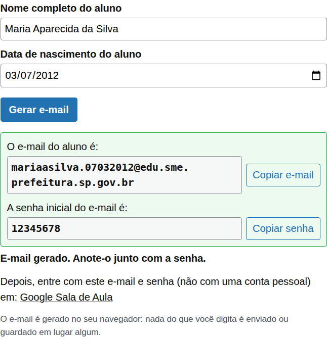
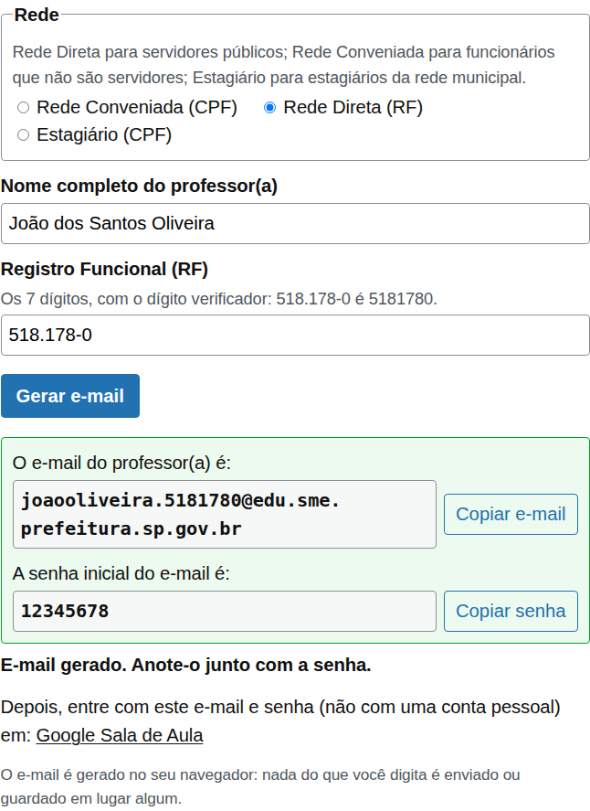
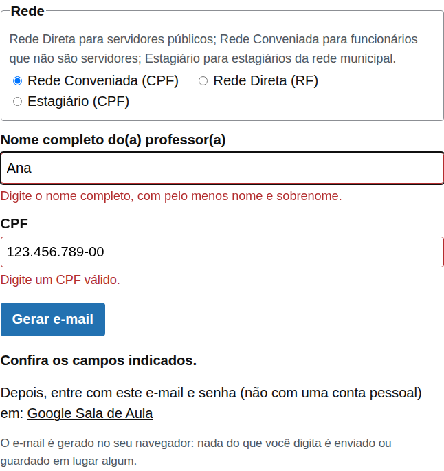
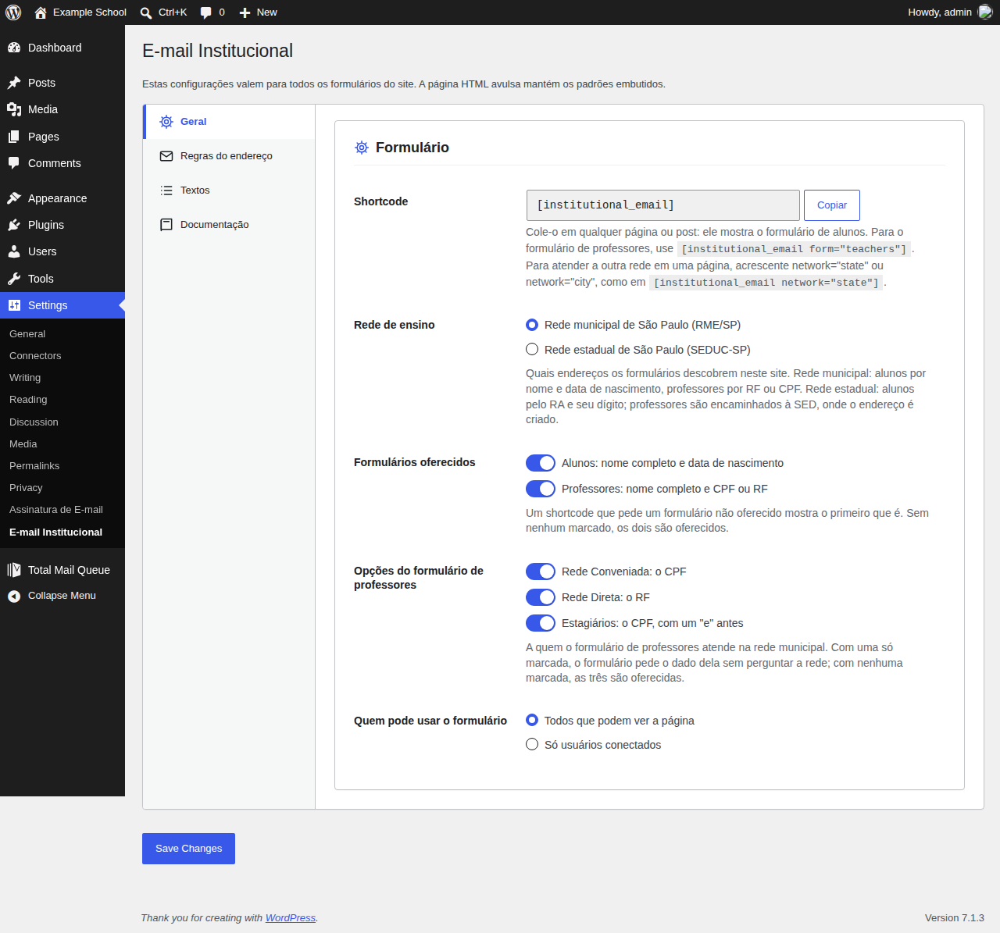
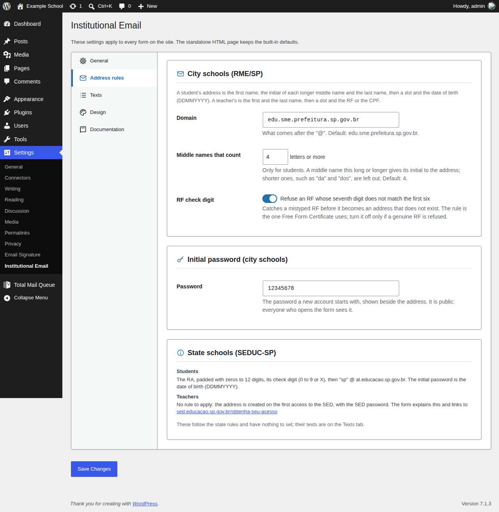
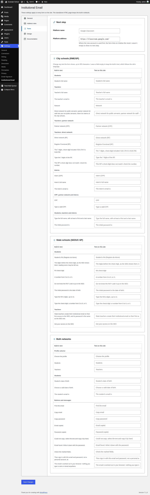
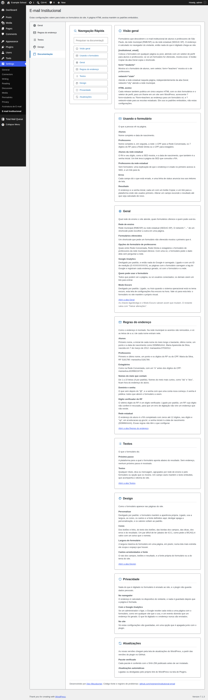
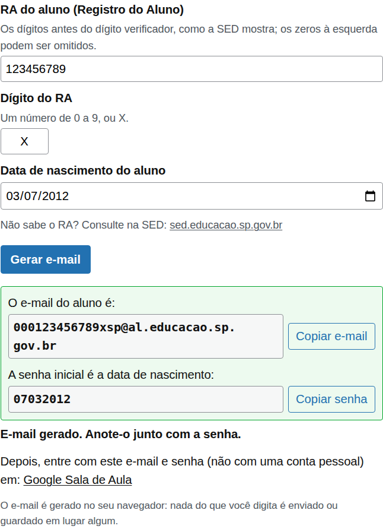
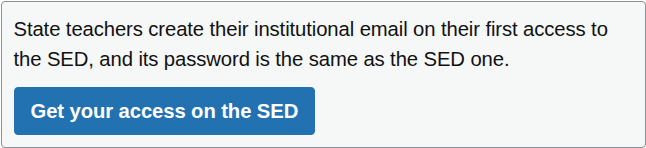
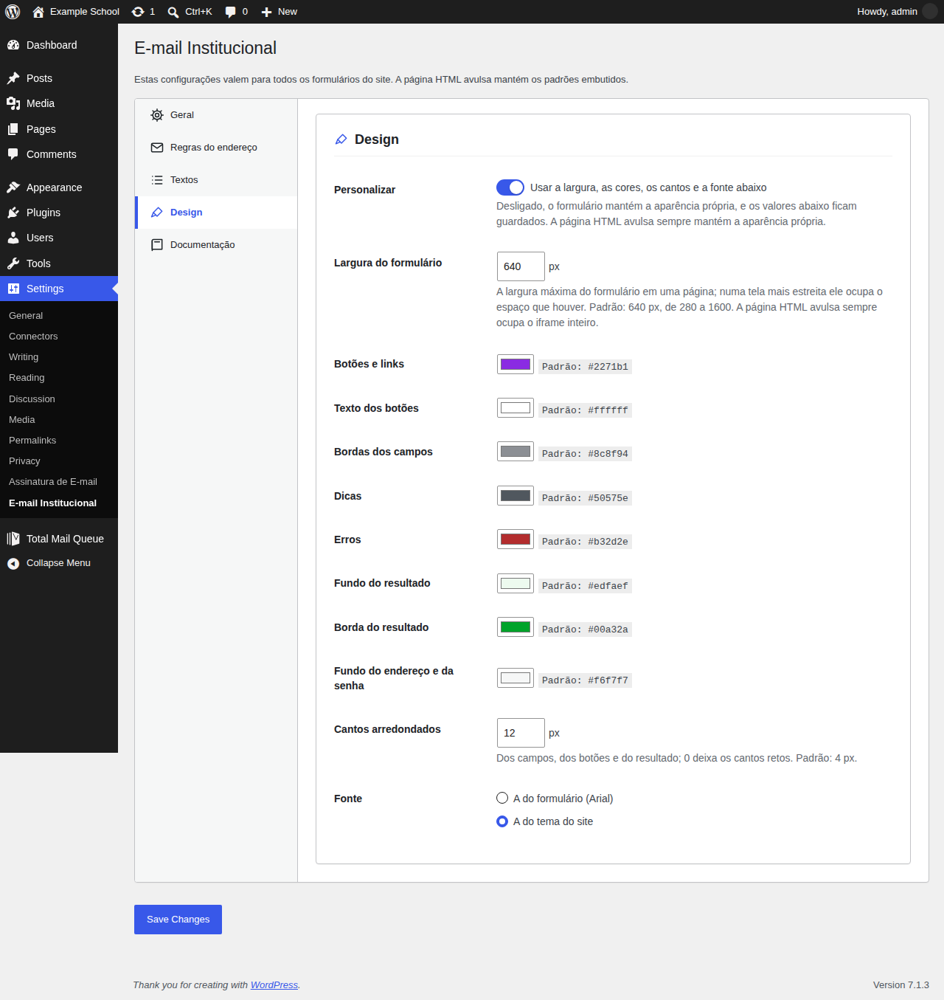

# Institutional Email

Forms that work out the institutional email address of São Paulo students and teachers: of the São Paulo Municipal Education Network (RME/SP), from their name and their date of birth, RF or CPF, or of the São Paulo state schools (SEDUC-SP), from the student's RA. The address is worked out in the visitor's browser: nothing typed is sent or stored anywhere.

It comes in two forms, both published on every [release](https://github.com/rpgmem/institutional-email/releases/latest):

- **WordPress plugin** (`institutional-email-X.Y.Z.zip`): place a form on any page with a shortcode. An administrator chooses the forms offered, who may use them, the address rules and every text the form shows. Updates arrive through the normal WordPress update screen.
- **Standalone HTML** (`institutional-email-X.Y.Z.html`): one self-contained file that needs no WordPress, for an `<iframe>` on any site. The latest one is served at **https://rpgmem.github.io/institutional-email/**.

**Requires** WordPress 6.8 or later and PHP 8.3 or later (plugin only) · **License** AGPLv3 or later



## The rules

| Who | Asked for | Address |
|---|---|---|
| Student | full name, date of birth | first name + the initial of each middle name of 4 letters or more + last name, a dot, the date as DDMMYYYY |
| Teacher, direct network | full name, RF (7 digits) | first name + last name, a dot, the RF |
| Teacher, partner network | full name, CPF (validated) | first name + last name, a dot, the CPF digits |
| Intern (on the teachers' form) | full name, CPF (validated) | first name + last name, a dot, `e`, the CPF digits |

All at `@edu.sme.prefeitura.sp.gov.br`, with the initial password `12345678`. The RF's seventh digit is a check digit, checked with Free Form Certificate's rule (an administrator can turn the check off), and RF and CPF are masked as `000.000-0` and `000.000.000-00`. Accents are dropped and only the letters a to z of each name reach the address. Examples: Maria Aparecida da Silva, born on 7 March 2012 → `mariaasilva.07032012@edu.sme.prefeitura.sp.gov.br`; João dos Santos Oliveira, RF 5181780 → `joaooliveira.5181780@edu.sme.prefeitura.sp.gov.br`.

### State schools (SEDUC-SP)

| Who | Asked for | Address |
|---|---|---|
| Student | RA, its check digit, date of birth | the RA padded with zeros to 12 digits + the check digit (0–9 or x) + `sp`, at `@al.educacao.sp.gov.br`; the initial password is the date of birth (DDMMYYYY) |
| Teacher | — | no rule: the address is created on the first access to the [SED](https://sed.educacao.sp.gov.br/obtenha-seu-acesso), with the SED password; the form explains this and links there |

Example: RA 123456789, check digit X, born on 7 March 2012 → `000123456789xsp@al.educacao.sp.gov.br`, password `07032012`.

## How to use it

**In WordPress**, put `[institutional_email]` on any page: it opens with a profile selector for students and teachers (or shows the only form offered). `[institutional_email form="students"]` or `form="teachers"` shows one form alone. The site serves the city or the state schools, as the General tab says; `network="state"` or `network="city"` on a shortcode serves the other one on that page.

In **Settings → Institutional Email** an administrator sets, for every form on the site:

- **General:** the school network (city or state), the forms offered, which of the partner network, the direct network and interns the teachers' form offers, who may use them (everyone, or logged-in users only), optional Google Analytics (off by default; only a GA4 measurement ID, never a pasted snippet), and this screen's Dark Mode (off, on, or following the operating system).
- **Address rules:** for the city schools, the domain, how long a middle name must be to give its initial, the RF check digit and the initial password; the state rules, which have nothing to set.
- **Texts:** the platform the result links to (Google Classroom by default; empty hides the line), and any label, hint or message of the form.
- **Design:** off by default; switched on, the form's width, the colours of the buttons, fields, hints, errors and result, the rounded corners and the font. Colour pairs below WCAG's 4.5:1 are saved with a warning.
- **Documentation:** what every option does, with examples.

**In an iframe**, without WordPress:

```html
<iframe src="https://rpgmem.github.io/institutional-email/" style="width:100%;height:640px;border:0" title="Institutional email"></iframe>
```

The page opens with the profile selector. Add `?form=students` or `?form=teachers` to the address for one form alone, and `?network=state` for the state schools (`?network=state&form=teachers` for both). The standalone page always uses the built-in rules and texts (in Portuguese). On a Google Site, use Insert → Embed → Embed code.

## Screenshots

| | |
|---|---|
|  |  |
|  |  |
|  |  |
|  |  |
|  | |

## Privacy

The address is computed by the script on the visitor's device: what is typed is never sent anywhere. By default the form sets no cookie and loads no third-party file. If an administrator switches on Google Analytics (off by default), the pages with a form load Google's tag, which sets Google's cookies, and record each address worked out with only the form and the network. The plugin stores only its own settings, in one option deleted with the plugin.

## Development

See [CLAUDE.md](CLAUDE.md) for the workflow (feature branches into `develop`, releases into `main`), the quality gates and the release steps, and [CHANGELOG.md](CHANGELOG.md) for the history, including the HTML versions from before the plugin (0.1.0–0.5.0).

## Credits

Created in 2020 by the Educational Technology team of [E.M.E.F. José Américo de Almeida](https://sites.google.com/view/emefjoseamericodealmeida/descubra-seu-e-mail-aluno) (DRE/MP, SME/SP), with Ricardo Fukui ([@rfukui](https://github.com/rfukui)), Rafael Meusburger ([@meusburger](https://github.com/meusburger)), Thiago Guttierre ([@thiagoguttierre](https://github.com/thiagoguttierre)), Alex Meusburger ([@rpgmem](https://github.com/rpgmem)) and other GitHub contributors. Maintained by [Alex Meusburger](https://github.com/rpgmem).

### Who used the 2020 forms

Regional offices and schools that embedded the original forms on their pages or shared them:

**Regional office departments:**

<details markdown="1">
<summary>Expand</summary>

[DIPED - DRE/IP](https://dipedtpaip.wixsite.com/tecnologia/tutoriais/)  
[DIPED - DRE/MP](https://dipedmp.wixsite.com/meusite/descubra-em-login-no-classroom)  
</details>


**Schools, by Regional Education Office (DRE):**

<details markdown="1">
<summary>Expand</summary>

**Escolas da Diretoria Regional de Educação de Campo Limpo (DRE/CL)**  
[C.E.U. E.M.E.F. Paraisópolis](https://sites.google.com/edu.sme.prefeitura.sp.gov.br/ceuemefparaispolis/)  

**Escolas da Diretoria Regional de Educação de Guaianases (DRE/G)**  
[E.M.E.F. Pres. Juscelino Kubitschek De Oliveira](https://sites.google.com/view/emefjk/in%C3%ADcio)  
[E.M.E.F. Prof. Claudia Bartolomazi](https://sites.google.com/edu.sme.prefeitura.sp.gov.br/emefprofclaudiabartolomazi)  
[E.M.E.F. Saturnino Pereira](https://sites.google.com/view/emef-saturnino-pereira/)  

**Escolas da Diretoria Regional de Educação Ipiranga (DRE/IP)**  
[E.M.E.F. José Maria Lisboa](http://emeflisboa.blogspot.com/2020/04/saiba-qual-e-o-seu-email-para-acessar.html) 

**Escolas da Diretoria Regional de Educação de São Miguel Paulista (DRE/MP)**  
[E.M.E.F. Armando Cridey Righetti](https://sites.google.com/view/emefarmandocrideyrighetti/in%C3%ADcio)  
[E.M.E.F. Alm. Pedro de Frontin](https://sites.google.com/view/almirantepedrodefrontin/e-mail-do-aluno)  
[E.M.E.F. Arq. Luis Saia](https://arquitetoluisaia.blogspot.com/)  
[E.M.E.F. Chico Falconi](https://www.facebook.com/EMEF-Padre-Chico-Falconi-482489571772521)  
[E.M.E.F. Dr. José  Pedro Leite Cordeiro](https://sites.google.com/edu.sme.prefeitura.sp.gov.br/emefdrjosepedroleitecordeiro/p%C3%A1gina-inicial/descubra-seu-email-do-classroom)  
[E.M.E.F. Hélio Tavares](http://helliotavares.blogspot.com/)  
[E.M.E.F. Henrique Felipe da Costa](https://sites.google.com/view/henricao/menu/google-classroom/descubra-seu-e-mail)  
[E.M.E.F. José Américo de Almeida](https://sites.google.com/view/emefjoseamericodealmeida/descubra-seu-e-mail-aluno)  
[E.M.E.F. Marisa Moretti Câmara](https://emefmarisamoretti.wixsite.com/meusite)  
[E.M.E.F. Madre Maria Imilda do Santíssimo Sacramento](http://madreonline3.webnode.com/)  
E.M.E.F. Mururés  
[E.M.E.F. Prof Carlos Pasquale](https://sites.google.com/view/pasquale20)  
[E.M.E.F. Prof. José Bento de Assis](https://sites.google.com/view/emefjosebentoprof/descubra-o-seu-emailaluno)  
[E.M.E.F. Prof. Jurandi Gomes de Araújo](https://sites.google.com/view/emefjurandigomes/in%C3%ADcio)  
[E.M.E.F. Raimundo Correia](https://www.facebook.com/emefraimundocorreia/)  
E.M.E.F. Sud Mennucci  
E.M.E.F. Vicente Amato  
E.M.E.F.M. Darcy Ribeiro  

**Escolas da Diretoria Regional de Educação da Penha (DRE/PE)**  
C.E.U. E.M.E.F. Prof. Rosangela Rodrigues Vieira  
[E.M.E.F. Anália Franco Bastos](https://sites.google.com/view/emefanaliafrancobastos/p%C3%A1gina-inicial)  

**Escolas da Diretoria Regional de Educação de Pirituba/Jaragua (DRE/PJ)**  
[E.M.E.F. Prof. Luiz David Sobrinho](https://sites.google.com/escolaluizdavid.com/capa/e-mail-edu-prefeitura)  

**Escolas da Diretoria Regional de Educação de Santo Amaro (DRE/SA)**  
[C.E.U. E.M.E.F. Prof. Paulo Gonçalo dos Santos - Site 1](https://sites.google.com/edu.sme.prefeitura.sp.gov.br/emefceualvarenga/cria%C3%A7%C3%A3o-de-email-institucional-do-alunoa)  
[C.E.U. E.M.E.F. Prof. Paulo Gonçalo dos Santos - Site 2](https://emefceualvarenga.blogspot.com/)  

**Escolas da Diretoria Regional de Educação de São Mateus (DRE/SM)**  
[E.M.E.F. Emílio Ribas](https://conexaoemilio.wixsite.com/emilioribas/orientacoes-covid-19)  
[E.M.E.F. Luiz Gonzaga do Nascimento Jr. Gonzaguinha](https://tgcairo.wixsite.com/emefgonzaguinha/e-mail-google/)  
</details>
